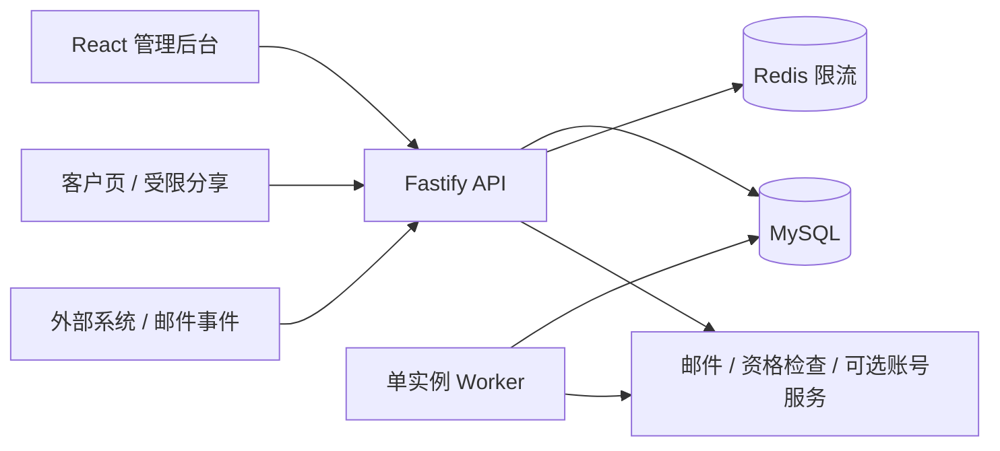
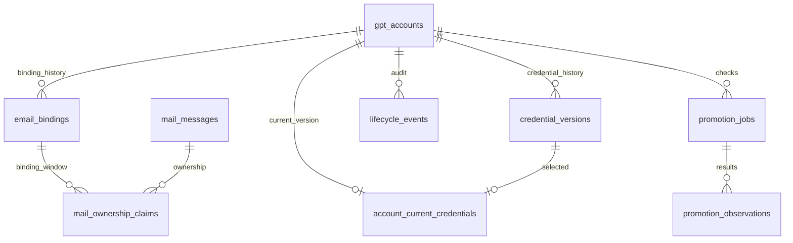
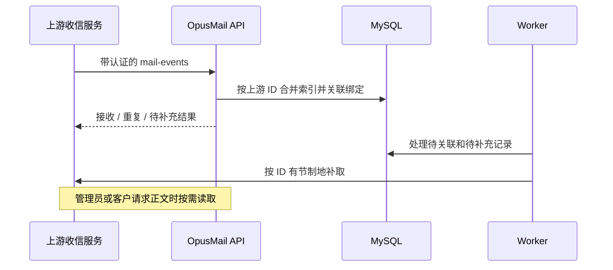

# 架构

OpusMail 将账号身份、邮箱绑定和凭证分别建模。邮箱会更换，凭证会更新，但账号的历史应连续；邮件则按收件地址和绑定区间关联，不能仅凭相似前缀合并身份。

## 运行结构

API 与 Worker 是独立进程，共用业务库与领域服务。Redis 只保存限流计数与到期时间，不承担消息队列、凭证缓存或邮件正文缓存。API 可以多实例；Worker 使用进程内调度，当前只运行一个。

| 位置 | 职责 |
| --- | --- |
| `src/server/server.ts`、`customer-routes.ts`、`compatibility-routes.ts` | 路由、认证、输入与响应边界 |
| `src/server/repository.ts` 及领域模块 | 账号查询、凭证、绑定、审计与业务状态转换 |
| `src/server/storage/` | MySQL 连接、事务、SQL 适配、结构迁移和旧库导入 |
| `src/server/infrastructure/` | Redis 原子限流 |
| `src/server/worker.ts` | 同步、待关联邮件补漏与资格检测调度 |
| `web/src/`、`src/shared/` | 管理界面与共享类型 |

## 核心关系

完整表结构见 [`schema-v1.ts`](../src/server/storage/schema-v1.ts)，当前包含 51 张业务表，另有结构版本表。这里的 `v1` 是 **MySQL 结构版本**，不表示运行时依赖旧 V1 服务。

- `gpt_accounts` 保存身份与生命周期，`email_bindings` 保存地址及有效区间。生成列上的唯一索引约束一个邮箱的当前归属和一个账号的当前绑定。
- `credential_versions` 保存加密凭证与版本关系，`account_current_credentials` 指向当前版本。身份指纹冲突进入审查，不能通过换绑绕过。
- `mail_messages` 保存上游消息 ID、收件时间和元数据；`mail_ownership_claims` 保存归属证据。正文按需读取，不持久化在本地业务库。
- 任务与检查结果分别保存。一次失败或未确定的响应不应覆盖上次明确观察；时间线保留判断依据。

## 连接、事务和迁移

[`mysql.ts`](../src/server/storage/mysql.ts) 使用 `mysql2` 异步连接池，每进程默认 10 个连接，等待队列上限 100。业务事务使用 SERIALIZABLE 隔离；AsyncLocalStorage 将事务内查询绑定到同一连接，嵌套事务使用 SAVEPOINT。事务失败回滚，不自动重放带有外部副作用的回调。

[`migrate.ts`](../src/server/storage/migrate.ts) 在专用连接上取得 MySQL 命名锁，并在**同一连接**执行全部结构语句，避免连接池只有一个连接时互相等待。版本记录在结构完成后写入。MySQL DDL 不能整批事务回滚，失败后需要查明原因并重新运行；建表、外键检查与初始化行支持重复执行。

[`mysql-sql.ts`](../src/server/storage/mysql-sql.ts) 集中适配已有 SQLite 风格查询。它覆盖当前业务使用的语法，并非通用 SQL 翻译器。新增数据库语义需在真实 MySQL 上验证，不能只靠离线 SQLite 测试。

旧 SQLite v29 通过显式导入命令进入空的 MySQL 库。导入只读源文件，校验结构、字段长度与外键，在一个事务中按依赖顺序写入并核对逐表 SHA-256，失败则回滚。没有启动时自动导入或运行时切回 SQLite 的路径。

## 邮件事件

主线使用事件接入与待处理记录补漏；不把定时扫描整个共享邮箱作为默认收件方式。上游必须提供可追踪的消息 ID 或足够的邮件内容，只有 `from/to/subject` 的通知不等于可取件的完整记录。具体输入契约见 [API](api.md#邮件事件)。

## 访问边界与运行检查

管理员使用签名会话；客户授权与分享令牌分别验证。管理员显式查看凭证时可以取得完整原文，客户和快照只返回各自允许的字段。敏感响应标记 `no-store`，日志不记录完整凭证。

Redis 限流使用 Lua 将计数和首次设置 TTL 作为原子操作。Redis 不可用时受限请求返回 503，避免多 API 各自放开额度。此机制是请求预算，不是业务缓存。

`/health` 用于存活检查，`/ready` 检查 MySQL 与 Redis。就绪不等于完成外部服务探测、全表完整性检查或备份恢复。备份、恢复和发布流程见[运行手册](mysql-redis.md)。
